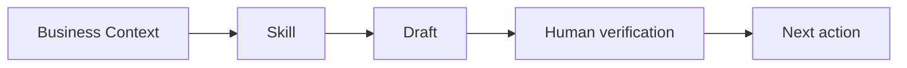

# Show Me

When the user selects a project, read `PROJECTS.md` at the Business OS root and its
`projects/<slug>/PROJECT.md`. Resolve input/output examples under that project;
shared `_context/`, `wiki/`, `_todos/`, and `skills/` stay at the Business OS root.

Help the user understand the current topic visually. Skip the preamble, keep prose brief, and pick
the smallest view that makes the key point clear.

## Brand preflight

Before creating any visual:

1. Read `_context/moodboard.md`. Treat it as the visual authority for palette, typography, mood,
   imagery, motifs, spacing, and avoid-list.
2. If `_context/moodboard.jpg` or `_context/moodboard.png` exists, inspect it with the runtime's available image capability and
   use it as supporting evidence. When it conflicts with the approved Markdown context, follow
   `_context/moodboard.md`.
3. Read only the other task-relevant Business Context files, such as `_context/brand.md`,
   `_context/customers.md`, or `_context/offers.md`, so labels and examples use confirmed business
   language and facts.
4. A direct instruction in the current request may override the moodboard. State the override in
   assumptions instead of silently changing the brand system.

If `_context/moodboard.md` is missing, stop branded production and recommend `ตั้งค่า business os`
or `อัปเดต moodboard` first. If it is incomplete, use only confirmed visual tokens and identify the
missing decisions; do not invent a brand palette, font, claim, number, or testimonial.

## Choose the smallest useful visual

- Use a compact table for exact comparisons or repeated-field mappings.
- Use a flowchart for a process, decision path, funnel, or journey.
- Use a sequence diagram for interactions that change over time.
- Use a shallow tree for hierarchy, ownership, file responsibility, or channel structure.
- Use pseudocode for logic or an algorithm.
- Use a diff when the point is what changes and the surrounding shape already exists.
- Use one focused HTML file for a visual UI, branded infographic, dashboard-like explanation,
  concept map, or short slide sequence that would be too dense in text or Mermaid.

For example, show a business workflow as Mermaid:



Show a decision or state change as a diff:

```diff
 Campaign idea
-  Generic audience
+  Confirmed ICP from customers.md
   Offer
+  Proof and CTA from offers.md
   Visual direction
+  Palette and mood from moodboard.md
```

Show the whole block when most of it is new, omitted context would hide ownership or order, or the
user needs a copyable target shape.

## Apply the moodboard

Translate the approved moodboard into the visual form instead of merely mentioning it:

- **HTML:** define CSS tokens for approved background, surface, text, primary, secondary, accent,
  border, radius, shadow, and type families. Apply the moodboard's density, imagery, motifs, and
  composition. Use system fallbacks for named fonts and keep the artifact usable offline unless the
  user supplied approved local assets.
- **Mermaid:** use supported theme variables and class styles derived from approved colors. Keep
  contrast readable; if the renderer cannot preserve styling, keep the branded terminology and
  state the rendering limitation.
- **Tables, trees, pseudocode, and diffs:** use approved brand terminology and tone. Styling is
  limited by the text format, so choose HTML when visual identity materially affects understanding.

Use real labels and confirmed data. Maintain accessible contrast, legible type, clear hierarchy,
and useful layouts on both desktop and mobile. Decorative choices must support the explanation.

## Deliver to the Proof Standard

Place an inline text or Mermaid visual next to the short explanation it supports. For HTML:

1. Save one self-contained file to
   `my-work/[YYYY-MM-DD] [task name]/show-me-[short-description].html`.
2. Open or preview it with the runtime's available local-file capability.
3. Report the moodboard tokens applied, assumptions or limitations, the human verification step,
   and the next action.

Keep only the facts, labels, states, and relationships needed for the current question. One strong
visual is the default; add another only when it answers a different necessary question.
